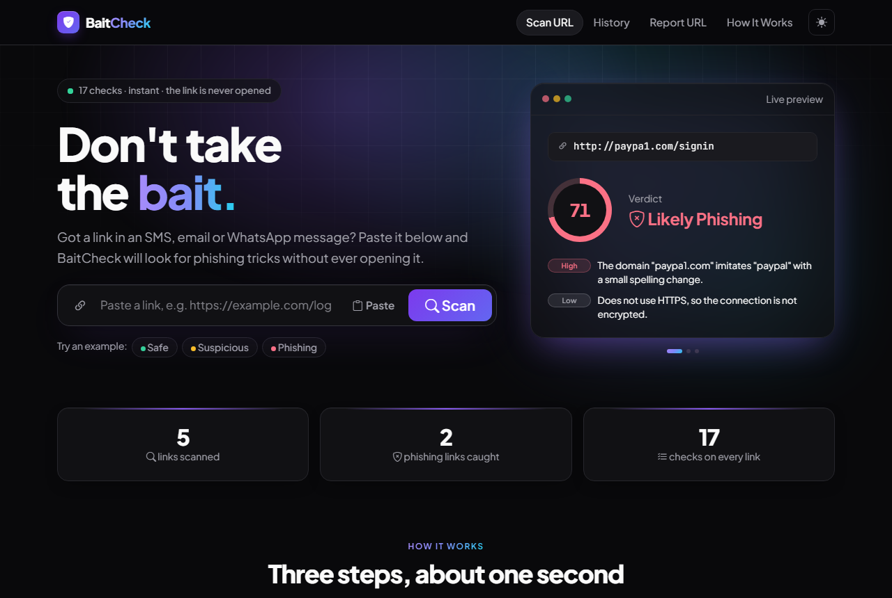
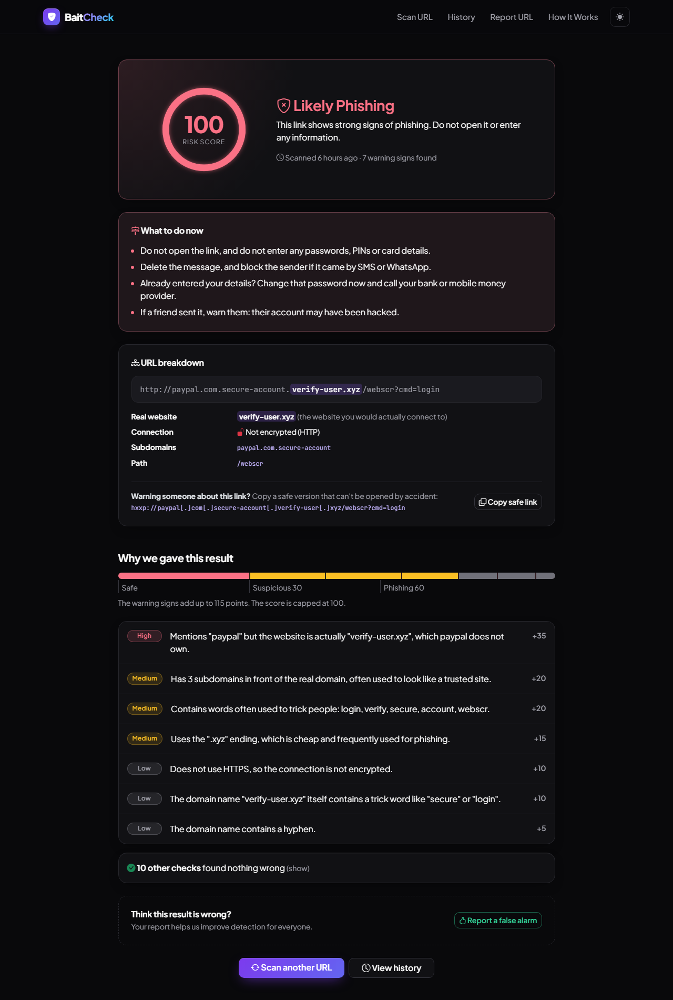
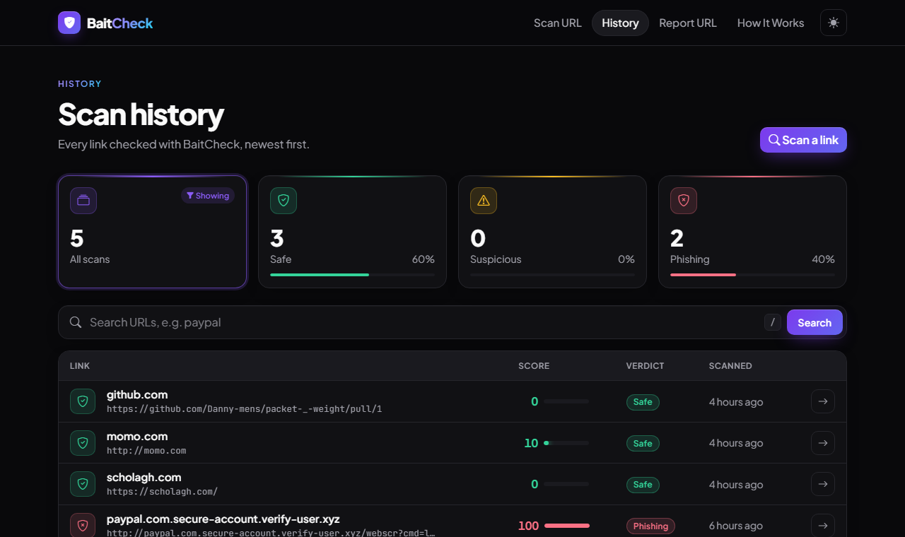
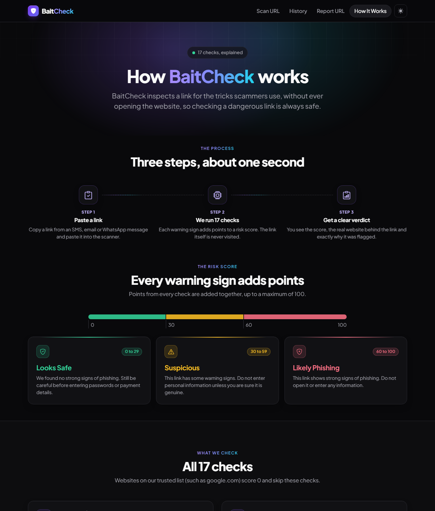
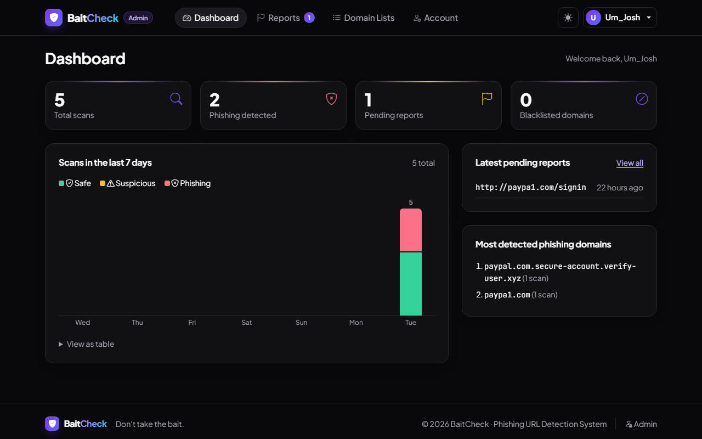
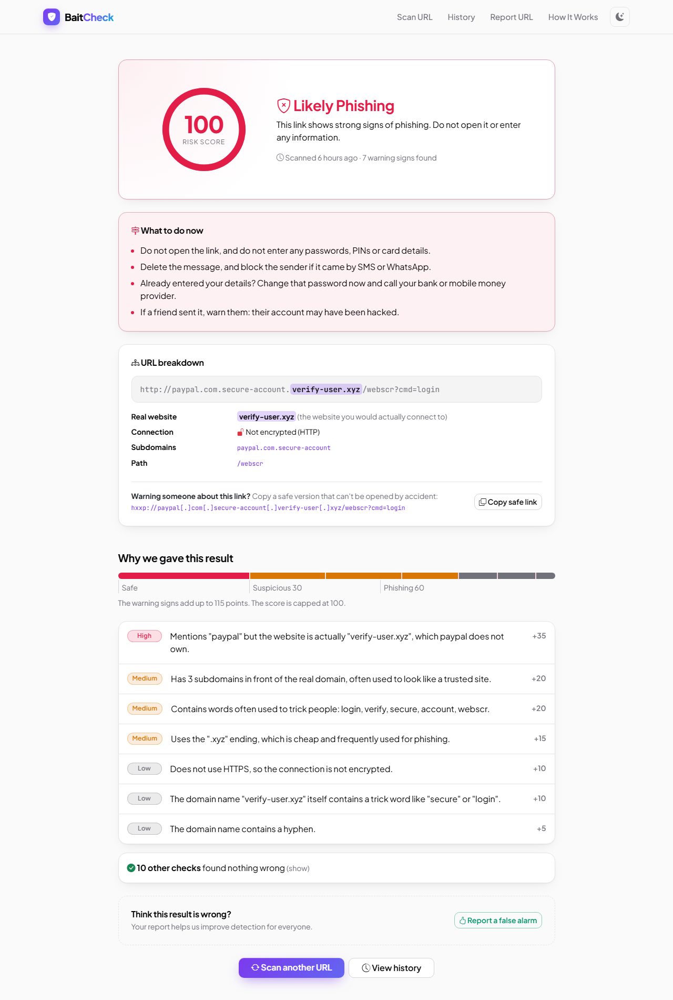
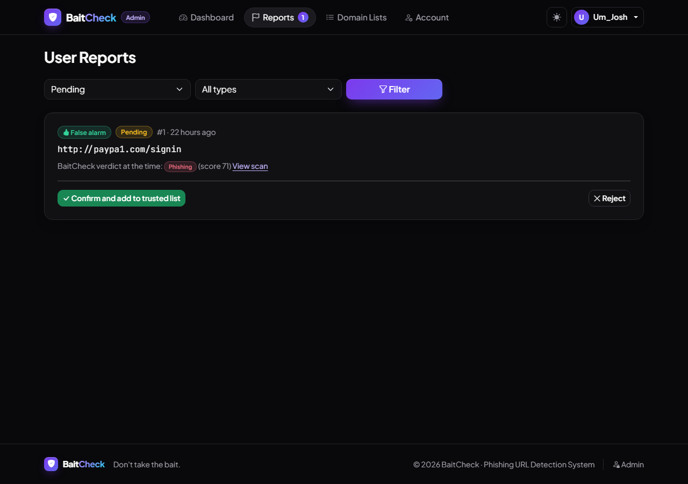

# BaitCheck: Phishing URL Detection System

BaitCheck checks a link for phishing before you click it. Paste a URL and it runs 17 rule-based
checks, gives a risk score from 0 to 100 with a verdict (**Safe**, **Suspicious** or **Phishing**) and
explains exactly why. The link itself is never opened, so checking a dangerous link is always safe.



## Features

**For everyone**
- **URL scanner** with paste and clear buttons, input validation, one-click example links and a short
  progress view that steps through the checks while the scan runs.
- **Detailed results:** animated risk gauge, a score bar showing how each warning sign adds up, a URL
  breakdown that highlights the real website behind the link, every warning sign ranked High, Medium
  or Low, the list of checks the link passed, and "what to do now" advice for the verdict.
- **Copy a safe link:** a "defanged" version (`hxxp://evil[.]com`) that can be shared in a warning
  without anyone opening it by accident.
- **Scan history** with summary cards that double as verdict filters, search with highlighted matches,
  score bars, pagination, and a card layout on phones.
- **Report a URL** that BaitCheck missed, or a genuine site it flagged by mistake.
- **How It Works** page explaining every check, the scoring and how to stay safe.

**For administrators**
- **Dashboard** with statistics, a 7-day chart of scans, pending reports and top phishing domains.
- **Report review:** confirming a report adds the domain to the blacklist or trusted list, applied to
  either the exact host or the whole domain.
- **Domain list management:** add, search and remove blacklist and trusted-list entries.
- **Account page** for changing the password.

**Everywhere**
- **Dark "Midnight Glow" design by default**, with a light mode one click away in the navbar (your choice is remembered).
- Works on phones, respects the "reduce motion" setting, and supports keyboard navigation.

## Screenshots

| Result page | Scan history |
|---|---|
|  |  |

| How It Works | Admin dashboard |
|---|---|
|  |  |

| Light mode | Admin report review |
|---|---|
|  |  |

## Tech stack

- HTML5, CSS3, Bootstrap 5.3, Bootstrap Icons, and the Plus Jakarta Sans and JetBrains Mono fonts
- JavaScript (no framework)
- PHP 8 (served by Apache from XAMPP)
- PostgreSQL, managed with pgAdmin 4

## Setup

You need XAMPP (for Apache and PHP) and PostgreSQL with pgAdmin 4.

1. **Get the code.** Clone this repository into `C:\xampp\htdocs\phishguard`.
2. **Enable PostgreSQL in PHP.** Open `C:\xampp\php\php.ini`, find these two lines and remove the
   `;` at the start of each, then restart Apache in the XAMPP Control Panel:
   ```
   extension=pdo_pgsql
   extension=pgsql
   ```
3. **Create the database.** In pgAdmin, right-click **Databases > Create > Database**, name it
   `phishguard` and save. Then right-click the new database > **Query Tool**, open
   `database/phishguard.sql` and press **Execute (F5)**.
4. **Add your password.** Copy `config/config.example.php` to `config/config.local.php` and put your
   PostgreSQL password in it. This file is ignored by git, so it is never uploaded.
5. **Open the site** at `http://localhost/phishguard`.

If you use a folder name other than `phishguard`, update the `ErrorDocument` path in `.htaccess`.

### Creating an admin account

There is no default admin password. The first time you open `http://localhost/phishguard/admin`
(also linked in the site footer), a setup page asks you to create the first admin account. It only
works from the computer running the site, and disappears once an admin exists.

To add another admin or reset a password, use the command line:

```
C:\xampp\php\php.exe tools\create_admin.php <username> <password>
```

## How detection works

Each rule that matches adds points to a risk score, capped at 100. Domains on the trusted list
(for example `google.com`) score 0, and domains on the blacklist score 100.

| Score | Verdict |
|-------|---------|
| 0 to 29 | Safe |
| 30 to 59 | Suspicious |
| 60 to 100 | Phishing |

| Check | Points |
|-------|--------|
| Domain on the blacklist | 100 |
| Misspelt brand name (`paypa1.com`, `faceb00k.com`) | 55 |
| IP address instead of a domain name | 45 |
| Brand name on a domain the brand does not own (`paypal.com.verify-user.xyz`) | 35 |
| Hidden `@` before the real website (`http://paypal.com@evil.com`) | 30 |
| Lookalike letters from other alphabets (punycode, `xn--`) | 25 |
| Many subdomains in front of the real domain | 8 or 20 |
| Link shortener hiding the destination | 20 |
| Trick words such as login, verify or update | 6 each, up to 20 |
| Cheap ending often used for phishing (`.tk`, `.xyz`, `.top`) | 15 |
| Hyphens in the domain name | 5 or 15 |
| Unusually long URL | 8 or 15 |
| Trick word inside the domain name itself | 10 |
| No HTTPS, unusual port, `//` redirect, heavy `%` encoding | 10 each |

The full list lives in `Detector::RULES` (`includes/Detector.php`). The How It Works page is built
from that list, and the tests check that it matches what the engine really does.

**Limitations.** BaitCheck inspects the link, not the website's content. A brand-new phishing site
on an ordinary-looking domain may score low, and a genuine site can occasionally be flagged. User
reports and the admin-managed lists exist to correct both cases.

## Admin workflow

1. Users report a URL as phishing or as a false alarm.
2. The admin reviews it under **Reports** and chooses to apply the decision to the exact host
   (for example `login.evil.xyz`) or the whole domain (`evil.xyz` and all its subdomains).
3. Confirming a phishing report adds the domain to the **blacklist**; confirming a false alarm adds it
   to the **trusted list**. The domain is removed from the opposite list, and all other pending reports
   for that domain are closed.
4. Rejecting a report changes no lists.

## Security measures

- All database queries use prepared statements (protection against SQL injection).
- All output is escaped with `htmlspecialchars` (protection against XSS).
- Every form that changes data carries a CSRF token.
- The report form has a hidden spam trap field and a limit of 5 reports per hour per IP address.
- Admin passwords are stored with `password_hash` (bcrypt), never in plain text.
- Admin login locks for 15 minutes after 5 failed attempts and gives the same message for unknown
  users and wrong passwords.
- The session ID is regenerated on login, and admins are logged out after 30 minutes of inactivity.
- Logout requires a POST request with a CSRF token.
- Redirects after login only go to pages inside the admin area (no open redirects).
- The database password is kept in `config/config.local.php`, which is never committed.
- The `config`, `includes`, `database`, `tests` and `tools` folders are blocked from browser access,
  and folder listings are disabled.
- Unexpected errors show a friendly page; technical details go to the server log only.

## Testing

Run the detection engine tests from the project folder:

```
C:\xampp\php\php.exe tests\detector_test.php
```

They cover 19 sample URLs (safe, suspicious and phishing), invalid input, and a check that every rule
on the How It Works page is real and tested. The whole application was also tested end to end in
the browser: scanning, history, reporting, every admin action, security protections (CSRF, spam
trap, rate limit, login lockout, SQL injection attempts) and layout at desktop and phone widths.

## Project structure

```
phishguard/
├── admin/
│   ├── setup.php            First-run admin account creation
│   ├── login.php            Admin login with lockout
│   ├── index.php            Dashboard: statistics and 7-day chart
│   ├── reports.php          Review user reports (confirm or reject)
│   ├── lists.php            Manage the blacklist and trusted list
│   ├── account.php          Change password
│   └── logout.php
├── assets/
│   ├── css/style.css
│   ├── img/favicon.svg
│   └── js/main.js
├── config/
│   ├── db.php               PostgreSQL connection and error handling
│   ├── config.example.php   Settings template (committed)
│   └── config.local.php     Your password (not committed)
├── database/phishguard.sql  PostgreSQL schema
├── docs/screenshots/        Images used in this README
├── includes/
│   ├── Detector.php         Detection engine (all phishing rules)
│   ├── auth.php             Admin login, lockout and session timeout
│   ├── functions.php        Shared helpers (escaping, CSRF, flash messages)
│   ├── head.php             Shared <head>: fonts, styles, saved light/dark theme
│   ├── steps.php            "How it works" steps (home and How It Works)
│   └── header.php, footer.php, admin_header.php, theme_toggle.php
├── tests/detector_test.php
├── tools/create_admin.php   Command-line admin account tool
├── index.php                Home page with URL scanner
├── scan.php                 Runs the detector and saves the scan
├── result.php               Risk gauge, URL breakdown and reasons
├── history.php              Past scans with stats, search, filter and pages
├── report.php               Report missed phishing links or false alarms
├── about.php                How It Works
└── 404.php                  Page not found
```

## Progress

- [x] Phase 1: Project setup, database, home page
- [x] Phase 2: Detection engine
- [x] Phase 3: Results page and scan history
- [x] Phase 4: URL reporting, blacklist and whitelist
- [x] Phase 5: Admin panel
- [x] Phase 6: How It Works page, testing and final polish
